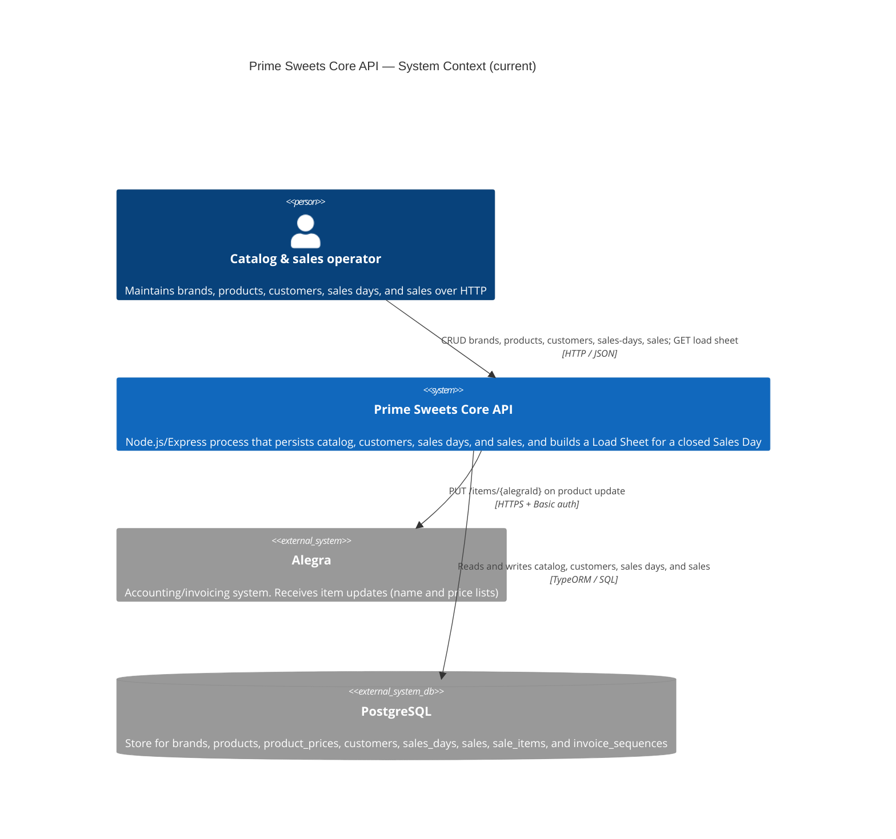

# C4 Level 1 — System Context (current)

**Sources:** `src/`, `package.json`.

The API persists brands, products, customers, sales days, and sales. On product update it syncs name and prices to Alegra. A closed Sales Day can produce a Load Sheet projection. There is no seller authentication and no invoice document rendering or printing.

## Diagram

## People

| Person | Relationship in code |
|---|---|
| Catalog & sales operator | Calls `/brands`, `/products`, `/customers`, `/sales-days`, `/sales`, and `/load-sheets/:salesDayId`. Routes have no login. Any HTTP client occupies this place. |

This repository has no frontend.

## External systems

| System | Role in code |
|---|---|
| PostgreSQL | Local store for brands, products, per-channel prices (`wholesale` / `retail`), customers, sales days, sales, sale items, and the invoice sequence. |
| Alegra | Outbound only. Local product stores `alegraId`. On name or price update, the API `PUT`s that item. There is no inbound sync (Alegra → API). |

Seller authentication, thermal printing, Excel catalog import, and invoice document rendering are Version 1 targets in the PDR/SPEC. They are not part of the current context. The Load Sheet is generated by the API and is not a stored document.
