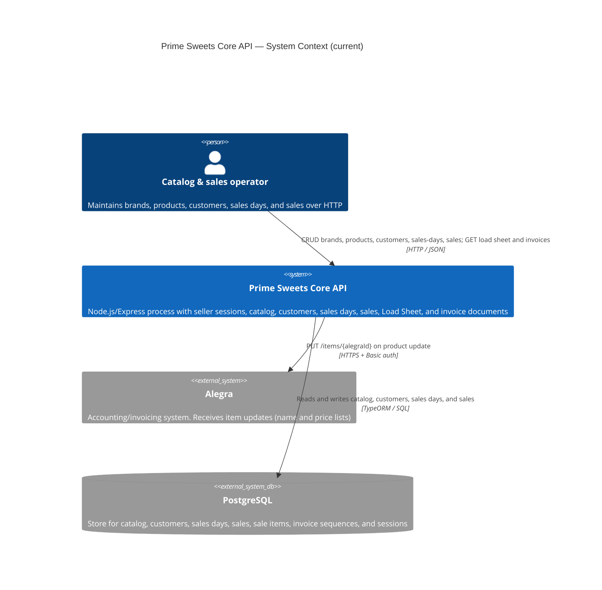

# C4 Level 1 — System Context (current)

**Sources:** `src/`, `package.json`.

The API persists brands, products, customers, sales days, sales, and seller sessions. On product update it syncs name and prices to Alegra; a later Alegra failure does not undo the saved product. A closed Sales Day can produce a Load Sheet projection. A Sales Day can list allocated invoices newest first, and a confirmed sale can be rendered as an invoice document. This process does not open a print dialog or send the invoice to a printer; the UI does that on the PC through Windows.

## Diagram

## People

| Person | Relationship in code |
|---|---|
| Catalog & sales operator | Signs in with `POST /auth/login` and calls `/brands`, `/products`, `/customers`, `/sales-days`, `/sales`, `/load-sheets/:salesDayId`, and `/invoices` with the bearer token. |

This repository has no frontend.

## External systems

| System | Role in code |
|---|---|
| PostgreSQL | Local store for brands, products, per-channel prices (`wholesale` / `retail`), customers, sales days, sales, sale items, and the invoice sequence. |
| Alegra | Outbound only. Local product stores `alegraId`. On name or price update, the API `PUT`s that item. There is no inbound sync (Alegra → API). |

Seller authentication is implemented: sessions live in PostgreSQL. Excel catalog import and Alegra inbound pull are still Version 1 targets in the PDR/SPEC. The Load Sheet, the invoice list, and the invoice document are generated by the API and are not stored documents. Invoice printing stays in the UI: the PC opens the Windows print dialog with that document. Company identity and legal text come from the validated application configuration (`COMPANY_*` via `loadAppConfig`).
