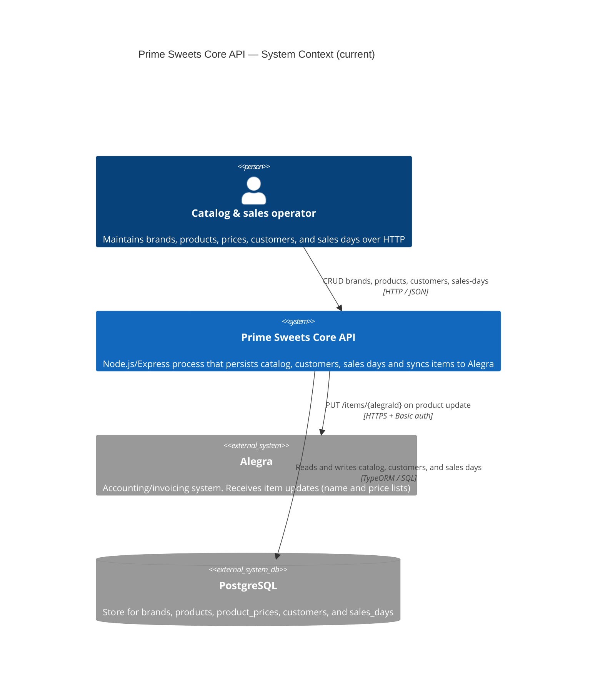

# C4 Level 1 — System Context (current)

**Sources:** `src/`, `package.json`.

The API (`prime-sweets-api-mngr`) persists brands, products, customers, sales days and, on product update, syncs name and prices to Alegra. There is no seller authentication, sales, invoices, or Load Sheet in this codebase.

## Diagram

## People

| Person | Relationship in code |
|---|---|
| Catalog & sales operator | Calls `/brands`, `/products`, `/customers`, `/sales-days`. Routes have no login. Any HTTP client (scripts, Postman, a future UI) occupies this place. |

This repository has no frontend.

## External systems

| System | Role in code |
|---|---|
| PostgreSQL | Local store for brands, products, per-channel prices (`wholesale` / `retail`), customers, and sales_days. |
| Alegra | Outbound only. Local product stores `alegraId`. On name or price update, the API `PUT`s that item. There is no inbound sync (Alegra → API). |

Seller-on-route, thermal printer, Excel catalog import, sales, and operational documents are Version 1 targets in the PDR/SPEC. They are not part of the current context.
