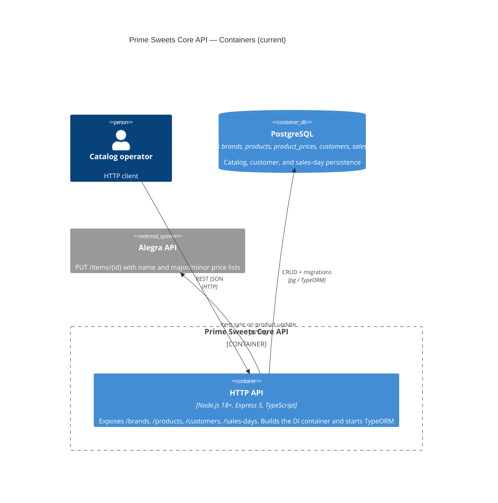

# C4 Level 2 — Containers (current)

**Sources:** `src/main.ts`, `src/apps/api/`, TypeORM DataSource, Alegra HTTP client.

One application process: the Express API. No workers, queues, or extracted services.

## Diagram

## HTTP API

`src/main.ts` loads `.env` and `reflect-metadata`, builds the `node-dependency-injection` container using typed TypeScript modules (`persistence.di`, `catalog.di`, `customer.di`, `salesDay.di`, `alegra.di`), initializes the TypeORM `DataSource`, and starts Express (`src/apps/api`).

`startApi` listens on `config.port` resolved from the DI container (defaulting to `3000` or `process.env.PORT`).

Stack: TypeScript CommonJS, Express 5, TypeORM 0.3, `pg`, `node-dependency-injection`.

## PostgreSQL

Schema from migrations `1760000000001` through `1760000000005`. Catalog ORM entities live in `src/shared/infrastructure/persistence/typeorm/`, customer entity in `src/contexts/customers/adapters/outbound/persistence/`, sales day entity in `src/contexts/sales-day/adapters/outbound/persistence/`. `synchronize` is `false`. Details: [data-model](../data-model/README.md).

## Alegra API (external)

`AlegraHttpClient` uses `ALEGRA_BASE_URL` and `ALEGRA_TOKEN`. Price lists are `ALEGRA_PRICE_LIST_MAJOR_ID` (wholesale) and `ALEGRA_PRICE_LIST_MINOR_ID` (retail).

## Deployment notes (verified)

| Topic | Current behavior |
|---|---|
| Deployable | One Node process. |
| Alegra delivery | Synchronous on the same `UpdateProduct` request. Persist runs first; if Alegra then fails, the use case returns failure while local data may already be saved. |
| Authentication | None on routes. |
