# C4 Level 3 — Components (current)

**Sources:** `src/contexts/`, `src/apps/`, `src/shared/`.

Top-level modules are the bounded contexts `identity`, `catalog`, `customers`, `sales`, `fulfillment-output`, and `alegra`. They use `application/ports` and `adapters/`. There is no `sales-day` context. Alegra's HTTP client lives in `adapters/outbound/http/`.

## Diagram

```mermaid
C4Component
title HTTP API — Components (current)

Container_Boundary(api, "Prime Sweets Core API") {
  Component(http, "HTTP inbound", "Express routers + httpResponse + validateRequest", "/brands, /products, /customers, /sales-days, /sales, /load-sheets, /invoices. Maps Result to JSON")
  Component(di, "Composition root", "TypeScript DI modules", "persistence.di, catalog.di, customer.di, salesDay.di, sales.di, fulfillmentOutput.di, alegra.di")

  Component(salesApp, "Sales application", "Sale use cases", "Create/Add/Update/Remove/Confirm/Void/Get/List")
  Component(salesDom, "Sales domain", "Sale aggregate, SaleItem entity, errors", "Financial calculations & invoice numbering")
  Component(salesInf, "Sales persistence", "TypeOrmSaleRepository + TypeOrmInvoiceNumberAllocator", "Atomicity & sequence")

  Component(fulfillmentApp, "Fulfillment application", "GenerateLoadSheet, ListInvoices, GenerateInvoice", "Load Sheet, invoice list, invoice document")
  Component(fulfillmentDom, "Fulfillment domain", "LoadSheet, InvoiceDocument", "Group by productId; render invoice from itemName")
  Component(fulfillmentInf, "Fulfillment queries", "Sales day, sale, customer, catalog, and company-profile adapters", "Read-only cross-context ports")

  Component(identityApp, "Identity", "Login and logout", "Bearer session. No sales-day context")

  Component(customersApp, "Customers application", "Customer use cases", "Create/Get/Search/Update")
  Component(customersDom, "Customers domain", "Customer entity, errors", "Customer model")
  Component(customersInf, "Customers persistence", "TypeOrmCustomerRepository + CustomerEntity", "Maps domain ↔ ORM")

  Component(productsApp, "Products application", "Brand/Product CRUD use cases", "Create/List/Get/Update/Delete")
  Component(productsDom, "Products domain", "Product, Brand, repositories, errors", "Local catalog model")
  Component(productsInf, "Products persistence", "TypeOrmProduct/BrandRepository", "Maps domain ↔ ORM")

  Component(alegraApp, "Alegra application", "SyncProductItemUseCase", "Builds price-list payload")
  Component(alegraPort, "ProductAlegraSyncService", "Port in products.domain", "Products does not import Alegra HTTP")
  Component(alegraInf, "Alegra infrastructure", "InProcessProductAlegraSync + AlegraHttpClient", "Outbound HTTP adapter")

  Component(shared, "Shared technical types", "Result, DomainError, TypeORM DataSource", "Cross-cutting utilities")
}

System_Ext(alegraExt, "Alegra")
ContainerDb(postgres, "PostgreSQL")

Rel(http, productsApp, "Invokes use cases")
Rel(productsApp, productsDom, "Creates/updates aggregates")
Rel(productsApp, productsInf, "via ProductRepository / BrandRepository")
Rel(productsInf, postgres, "SQL")
Rel(productsApp, alegraPort, "UpdateProduct.sync()")
Rel(alegraPort, alegraInf, "in-process implementation")
Rel(alegraInf, alegraApp, "delegates SyncProductItem")
Rel(alegraApp, alegraExt, "PUT /items")
Rel(di, http, "Resolves use cases")
Rel(di, productsApp, "Wires repositories and sync")
Rel(http, fulfillmentApp, "GET /load-sheets and GET /invoices by deliveryDate")
Rel(fulfillmentApp, fulfillmentDom, "LoadSheet.compose")
Rel(fulfillmentApp, fulfillmentInf, "via outbound query ports")
Rel(fulfillmentInf, salesInf, "SaleRepository.list confirmed")
Rel(fulfillmentInf, productsInf, "product and brand display")
Rel(http, shared, "httpResponse(Result)")
Rel(productsApp, shared, "Result")
```



## Folder map

```text
src/
  main.ts
  apps/
    api/                           inbound HTTP
    controllers/httpResponse.ts
    dependency-injection/          *.di.ts composition modules
      acl/                         adapters that read another context
  contexts/
    identity/                      login, logout, session
    catalog/
    customers/
    sales/
    fulfillment-output/            Load Sheet and invoice document by delivery date; no persistence
    alegra/                        outbound HTTP client and item sync
  shared/
    application/result/
    domain/errors/
    infrastructure/config/         loadAppConfig
    infrastructure/persistence/typeorm/
```

## HTTP API

| Method | Path | Use case |
|---|---|---|
| GET/POST | `/brands` | List / Create Brand |
| GET/PUT/DELETE | `/brands/:id` | Get / Update / Delete Brand |
| POST | `/auth/login` | Start a session |
| POST | `/auth/logout` | End the session |
| GET/POST | `/products` | Page / Create Product. `page`, `pageSize`, and `q` page the catalog |
| GET | `/products/search` | Search Products |
| GET/PUT/DELETE | `/products/:id` | Get / Update / Delete Product |
| GET/POST | `/customers` | List / Search / Create Customer |
| GET | `/customers/search` | Search Customers |
| GET/PUT | `/customers/:id` | Get / Update Customer |
| GET/POST | `/sales` | List by delivery date / Create Draft Sale |
| GET | `/sales/:id` | Get Sale details |
| PATCH | `/sales/:id/delivery-date` | Move a draft, or void and reissue a confirmed sale |
| POST | `/sales/:id/items` | Add item to Sale |
| PUT | `/sales/:id/items/:itemId/quantity` | Update item quantity |
| PUT | `/sales/:id/items/:itemId/name` | Update the draft line name |
| DELETE | `/sales/:id/items/:itemId` | Remove item from Sale |
| POST | `/sales/:id/confirm` | Confirm Sale and allocate Invoice Number |
| POST | `/sales/:id/void` | Void a confirmed Sale |
| GET | `/load-sheets?deliveryDate=` | Load Sheet for that delivery date |
| GET | `/invoices?deliveryDate=` | List invoices for that delivery date |
| GET | `/invoices/:saleId` | Generate the invoice document for a confirmed or voided Sale |

`httpResponse` maps `Result`: 200/201 success, 404 `NotFoundError`, 400 `DomainError`, 500 otherwise.

`CreateProduct` and `DeleteProduct` do not call Alegra. `CreateProduct` requires `alegraId` and treats it as already existing in Alegra.

`GET /load-sheets?deliveryDate=` reads confirmed sales for that delivery date. It does not persist a Load Sheet and does not write Sales tables.

`GET /invoices?deliveryDate=` reads allocated invoice numbers for that delivery date. It does not write Sales tables.

`GET /invoices/:saleId` renders a confirmed or voided sale into an invoice document. It does not write Sales tables and does not allocate an invoice number. The UI prints that document with the Windows print dialog. This API has no printer adapter.

There is no `/sales-days` route. Alegra uses `application/ports/outbound` and `adapters/outbound/http`.
