# C4 Level 3 — Components (current)

**Sources:** `src/contexts/`, `src/apps/`, `src/shared/`.

Top-level modules are the bounded contexts `catalog`, `customers`, `sales-day`, `sales`, `fulfillment-output`, and `alegra`. `catalog`, `customers`, `sales-day`, `sales`, and `fulfillment-output` use `application/ports` and `adapters/`. `alegra` still uses `domain/interfaces` and `infrastructure/`.

## Diagram

```mermaid
C4Component
title HTTP API — Components (current)

Container_Boundary(api, "Prime Sweets Core API") {
  Component(http, "HTTP inbound", "Express routers + httpResponse + validateRequest", "/brands, /products, /customers, /sales-days, /sales, /load-sheets. Maps Result to JSON")
  Component(di, "Composition root", "TypeScript DI modules", "persistence.di, catalog.di, customer.di, salesDay.di, sales.di, fulfillmentOutput.di, alegra.di")

  Component(salesApp, "Sales application", "Sale use cases", "Create/Add/Update/Remove/Confirm/Void/Get/List")
  Component(salesDom, "Sales domain", "Sale aggregate, SaleItem entity, errors", "Financial calculations & invoice numbering")
  Component(salesInf, "Sales persistence", "TypeOrmSaleRepository + TypeOrmInvoiceNumberAllocator", "Atomicity & sequence")

  Component(fulfillmentApp, "Fulfillment application", "GenerateLoadSheetUseCase, ListInvoicesUseCase", "Load Sheet projection and invoice list")
  Component(fulfillmentDom, "Fulfillment domain", "LoadSheet", "Group by productId; sum quantity, total, profit")
  Component(fulfillmentInf, "Fulfillment queries", "SalesDay, confirmed sale items, catalog display adapters", "Read-only cross-context ports")

  Component(salesDayApp, "Sales Day application", "Sales Day use cases", "Open/GetCurrent/Close/Reopen")
  Component(salesDayDom, "Sales Day domain", "SalesDay aggregate root, errors, date provider", "Operational daily lifecycle")
  Component(salesDayInf, "Sales Day persistence", "TypeOrmSalesDayRepository + SalesDayEntity", "Maps domain ↔ ORM")

  Component(customersApp, "Customers application", "Customer use cases", "Create/Get/Search/Update")
  Component(customersDom, "Customers domain", "Customer entity, errors", "Customer model")
  Component(customersInf, "Customers persistence", "TypeOrmCustomerRepository + CustomerEntity", "Maps domain ↔ ORM")

  Component(productsApp, "Products application", "Brand/Product CRUD use cases", "Create/List/Get/Update/Delete")
  Component(productsDom, "Products domain", "Product, Brand, repositories, errors", "Local catalog model")
  Component(productsInf, "Products persistence", "TypeOrmProduct/BrandRepository", "Maps domain ↔ ORM")

  Component(alegraApp, "Alegra application", "SyncProductItemUseCase", "Builds price-list payload")
  Component(alegraPort, "ProductAlegraSyncService", "Port in products.domain", "Products does not import Alegra HTTP")
  Component(alegraInf, "Alegra infrastructure", "InProcessProductAlegraSync + AlegraHttpClient", "Outbound HTTP adapter")

  Component(shared, "Shared technical types", "Result, DomainError, TypeORM DataSource", "Cross-cutting utilities")
}

System_Ext(alegraExt, "Alegra")
ContainerDb(postgres, "PostgreSQL")

Rel(http, productsApp, "Invokes use cases")
Rel(productsApp, productsDom, "Creates/updates aggregates")
Rel(productsApp, productsInf, "via ProductRepository / BrandRepository")
Rel(productsInf, postgres, "SQL")
Rel(productsApp, alegraPort, "UpdateProduct.sync()")
Rel(alegraPort, alegraInf, "in-process implementation")
Rel(alegraInf, alegraApp, "delegates SyncProductItem")
Rel(alegraApp, alegraExt, "PUT /items")
Rel(di, http, "Resolves use cases")
Rel(di, productsApp, "Wires repositories and sync")
Rel(http, fulfillmentApp, "GET /load-sheets/:salesDayId")
Rel(fulfillmentApp, fulfillmentDom, "LoadSheet.compose")
Rel(fulfillmentApp, fulfillmentInf, "via outbound query ports")
Rel(fulfillmentInf, salesInf, "SaleRepository.list confirmed")
Rel(fulfillmentInf, salesDayInf, "SalesDayRepository.findById")
Rel(fulfillmentInf, productsInf, "product and brand display")
Rel(http, shared, "httpResponse(Result)")
Rel(productsApp, shared, "Result")
```



## Folder map

```text
src/
  main.ts
  apps/
    api/                           inbound HTTP
    controllers/httpResponse.ts
    dependency-injection/          *.di.ts composition modules
  contexts/
    catalog/
    customers/
    sales-day/
    sales/
    fulfillment-output/            Load Sheet generation; no persistence
    alegra/
  shared/
    application/result/
    domain/errors/
    infrastructure/persistence/typeorm/
```

## HTTP API

| Method | Path | Use case |
|---|---|---|
| GET/POST | `/brands` | List / Create Brand |
| GET/PUT/DELETE | `/brands/:id` | Get / Update / Delete Brand |
| GET/POST | `/products` | List / Create Product |
| GET/PUT/DELETE | `/products/:id` | Get / Update / Delete Product |
| GET/POST | `/customers` | List (Search) / Create Customer |
| GET/PUT | `/customers/:id` | Get / Update Customer |
| POST | `/sales-days/open` | Open current Sales Day |
| GET | `/sales-days/current` | Get current Sales Day |
| POST | `/sales-days/:id/close` | Close Sales Day |
| POST | `/sales-days/:id/reopen` | Reopen current Sales Day |
| GET/POST | `/sales` | List / Create Draft Sale |
| GET | `/sales/:id` | Get Sale details |
| POST | `/sales/:id/items` | Add item to Sale |
| PUT | `/sales/:id/items/:productId/quantity` | Update item quantity |
| PUT | `/sales/:id/items/:productId/name` | Update transaction-time item name |
| DELETE | `/sales/:id/items/:productId` | Remove item from Sale |
| POST | `/sales/:id/confirm` | Confirm Sale and allocate Invoice Number |
| POST | `/sales/:id/void` | Void Confirmed Sale logically |
| GET | `/load-sheets/:salesDayId` | Generate Load Sheet for a closed Sales Day |
| GET | `/invoices?salesDayId=` | List invoices already allocated on a Sales Day |

`httpResponse` maps `Result`: 200/201 success, 404 `NotFoundError`, 400 `DomainError`, 500 otherwise.

`CreateProduct` and `DeleteProduct` do not call Alegra. `CreateProduct` requires `alegraId` and treats it as already existing in Alegra.

`GET /load-sheets/:salesDayId` reads a closed Sales Day and confirmed sales. It does not persist a Load Sheet and does not write Sales tables.

`GET /invoices?salesDayId=` reads allocated invoice numbers for that Sales Day. It accepts an open or closed day and does not write Sales tables.

Invoice rendering and printing (`fulfillment-output` document adapters) are not present. `alegra` still uses the legacy `infrastructure/` layout.
