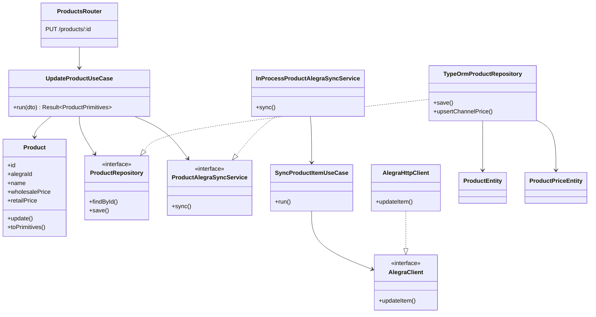
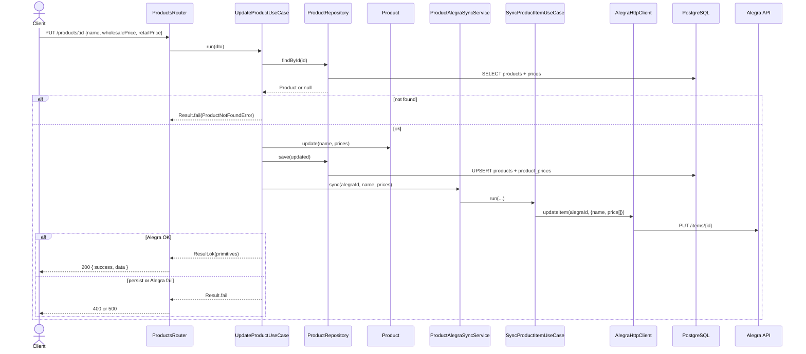

# C4 Level 4 — Code (current)

**Verified critical flow:** update a product, persist locally, then sync name/prices to Alegra.

**Sources:** `UpdateProductUseCase`, `InProcessProductAlegraSyncService`, `SyncProductItemUseCase`, `AlegraHttpClient`, `TypeOrmProductRepository`.

Other use cases are local brand/product CRUD. See [flows](../flows/README.md).

## Dependencies

## Sequence

`UpdateProduct` accepts `name`, `wholesalePrice`, and/or `retailPrice` only. It does not change cost, brand, units, pack, or `alegraId`.

ConfirmSale, invoice numbering, Sales Day transitions, and Load Sheet aggregation are specified in the SPEC and are not implemented. They are not documented as code here.
