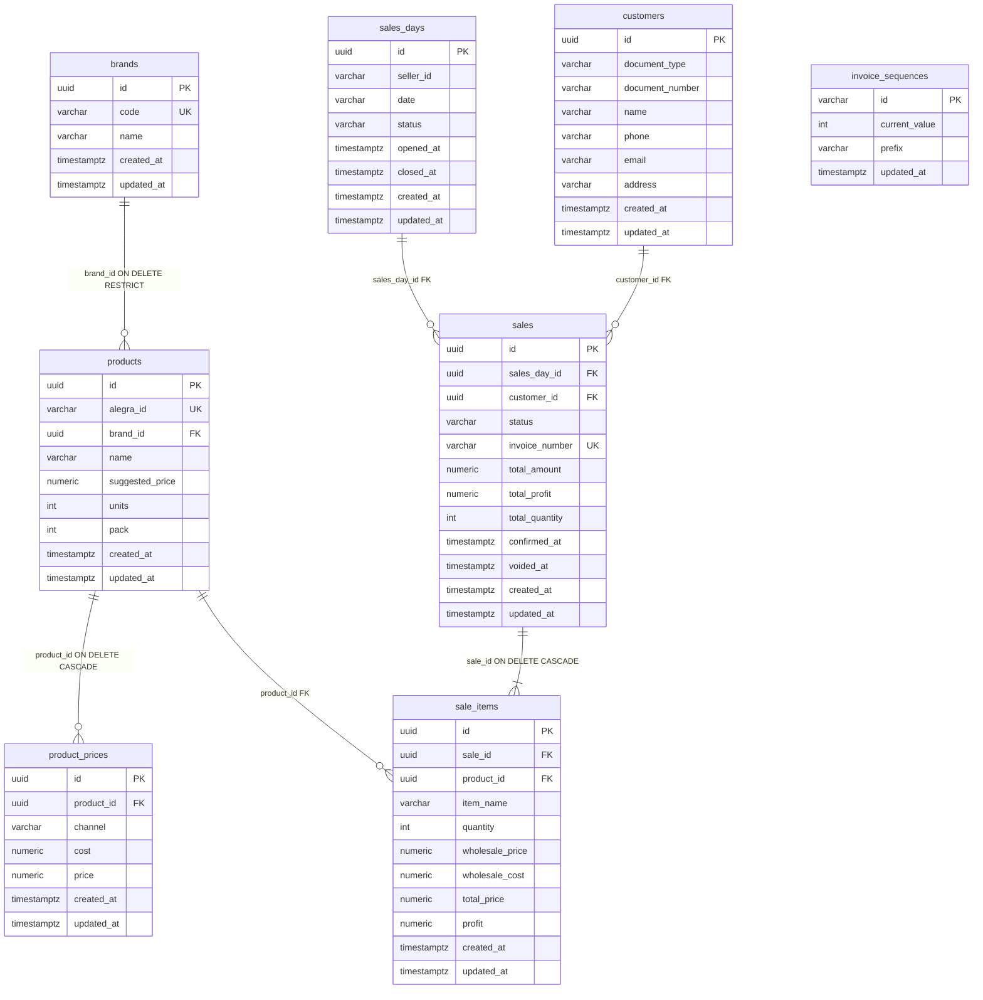

# Data model (current)

**Sources:** TypeORM entities, migrations `1760000000001-CreateBrands.ts` through `1760000000007-UniqueCustomerDocument.ts`, `TypeOrmDataSource`, domain `Product` / `Brand` / `Customer` / `SalesDay` / `Sale` / `SaleItem`, TypeORM repositories.

Tables registered on the DataSource and created by migrations are documented below.

## Schema

`TypeOrmDataSource` registers `BrandEntity`, `ProductEntity`, `ProductPriceEntity`, `CustomerEntity`, `SalesDayEntity`, `SaleEntity`, `SaleItemEntity`, `InvoiceSequenceEntity`. `synchronize` is `false`.

## Tables

### `brands`

| Column | Type | Constraints |
|---|---|---|
| `id` | uuid | PK |
| `code` | varchar(32) | NOT NULL, UNIQUE |
| `name` | varchar(255) | NOT NULL |
| `created_at` / `updated_at` | timestamptz | default `now()` |

### `products`

| Column | Type | Constraints |
|---|---|---|
| `id` | uuid | PK |
| `alegra_id` | varchar(64) | NOT NULL, UNIQUE |
| `brand_id` | uuid | nullable, FK to `brands(id)` ON DELETE RESTRICT |
| `name` | varchar(255) | nullable |
| `suggested_price` | numeric(12,2) | nullable |
| `units` | integer | NOT NULL, default `0` |
| `pack` | integer | NOT NULL, default `0` |
| `created_at` / `updated_at` | timestamptz | default `now()` |

### `product_prices`

| Column | Type | Constraints |
|---|---|---|
| `id` | uuid | PK |
| `product_id` | uuid | NOT NULL, FK to `products(id)` ON DELETE CASCADE |
| `channel` | varchar(20) | NOT NULL, CHECK `IN ('wholesale', 'retail')` |
| `cost` | numeric(12,2) | nullable |
| `price` | numeric(12,2) | NOT NULL |
| `created_at` / `updated_at` | timestamptz | default `now()` |

Unique: `(product_id, channel)`.

### `customers`

| Column | Type | Constraints |
|---|---|---|
| `id` | uuid | PK |
| `document_type` | varchar(32) | NOT NULL |
| `document_number` | varchar(64) | NOT NULL |
| `name` | varchar(255) | NOT NULL |
| `phone` | varchar(64) | nullable |
| `email` | varchar(255) | nullable |
| `address` | varchar(255) | nullable |
| `created_at` / `updated_at` | timestamptz | default `now()` |

Unique index: `UQ_customers_document` on `(LOWER(document_type), document_number)`. The type comparison ignores case, matching `findByDocument`. The number is exact. Migration `1760000000007` replaces the previous non-unique index. Creating it fails if that pair is already repeated and does not delete rows.

### `sales_days`

| Column | Type | Constraints |
|---|---|---|
| `id` | uuid | PK |
| `seller_id` | varchar(64) | NOT NULL |
| `date` | varchar(10) | NOT NULL |
| `status` | varchar(10) | NOT NULL, default `'OPEN'`, CHECK `IN ('OPEN', 'CLOSED')` |
| `opened_at` | timestamptz | NOT NULL, default `now()` |
| `closed_at` | timestamptz | nullable |
| `created_at` / `updated_at` | timestamptz | default `now()` |

Unique & Index: `IDX_sales_days_seller_date` on `(seller_id, date)`.

### `sales`

| Column | Type | Constraints |
|---|---|---|
| `id` | uuid | PK |
| `sales_day_id` | uuid | NOT NULL, FK to `sales_days(id)` |
| `customer_id` | uuid | NOT NULL, FK to `customers(id)` |
| `status` | varchar(20) | NOT NULL, default `'DRAFT'`, CHECK `IN ('DRAFT', 'CONFIRMED', 'VOIDED')` |
| `invoice_number` | varchar(50) | nullable, UNIQUE |
| `total_amount` | numeric(12,2) | NOT NULL, default `0` |
| `total_profit` | numeric(12,2) | NOT NULL, default `0` |
| `total_quantity` | integer | NOT NULL, default `0` |
| `confirmed_at` | timestamptz | nullable |
| `voided_at` | timestamptz | nullable |
| `created_at` / `updated_at` | timestamptz | default `now()` |

Indexes: `IDX_sales_sales_day_id`, `IDX_sales_customer_id`, `IDX_sales_invoice_number`.

### `sale_items`

| Column | Type | Constraints |
|---|---|---|
| `id` | uuid | PK |
| `sale_id` | uuid | NOT NULL, FK to `sales(id)` ON DELETE CASCADE |
| `product_id` | uuid | NOT NULL, FK to `products(id)` |
| `item_name` | varchar(255) | NOT NULL |
| `quantity` | integer | NOT NULL |
| `wholesale_price` | numeric(12,2) | NOT NULL |
| `wholesale_cost` | numeric(12,2) | NOT NULL |
| `total_price` | numeric(12,2) | NOT NULL |
| `profit` | numeric(12,2) | NOT NULL |
| `created_at` / `updated_at` | timestamptz | default `now()` |

Indexes: `IDX_sale_items_sale_id`, `IDX_sale_items_product_id`.

### `invoice_sequences`

| Column | Type | Constraints |
|---|---|---|
| `id` | varchar(32) | PK (e.g. `'default'`) |
| `current_value` | integer | NOT NULL, default `0` |
| `prefix` | varchar(10) | NOT NULL, default `'INV-'` |
| `updated_at` | timestamptz | default `now()` |

Initial seed row: `('default', 0, 'INV-')`.

## Domain mapping

Domain `Product` holds wholesale/retail cost and price as fields. Persistence splits them into at most two `product_prices` rows.

| Domain field | Storage |
|---|---|
| `id`, `alegraId`, `brandId`, `name`, `suggestedPrice`, `units`, `pack` | `products` columns |
| `wholesaleCost`, `wholesalePrice` | row `channel = 'wholesale'` |
| `retailCost`, `retailPrice` | row `channel = 'retail'` |

Domain `Customer` maps 1:1 with columns in `customers`.
Domain `SalesDay` maps 1:1 with columns in `sales_days`.
Domain `Sale` aggregate root maps to `sales`, cascading and synchronizing items with `sale_items`.
Domain `SaleItem` stores transaction-time snapshot of pricing and customized `itemName`.

`TypeOrmProductRepository.save`:

- Upserts `products`.
- For each channel, if `price` is a number, upserts the channel row (including nullable `cost`).
- If `price` is `null`, deletes that channel row.
- If `price` is `undefined`, the channel row is left unchanged.

`TypeOrmSaleRepository.save`:
- Atomically in transaction saves the sale record and synchronizes its `sale_items`.

`TypeOrmInvoiceNumberAllocator.allocateNext`:
- Uses atomic PostgreSQL `INSERT ... ON CONFLICT ("id") DO UPDATE SET current_value = current_value + 1 RETURNING ...` to ensure monotonic, immediate, non-reusable invoice numbering.

## Load Sheet

The Load Sheet is not a table. `GenerateLoadSheet` builds it in memory from confirmed `sale_items` of a closed `sales_days` row and from Catalog `products` / `brands` display fields. Nothing is inserted or updated. See [flows](../flows/README.md).

## Invoice list

`ListInvoices` is not a table. It reads `sales` rows that already have an `invoice_number` (`CONFIRMED` or `VOIDED`) for a Sales Day and returns a summary. It does not insert or update rows.

## Invoice document

`GenerateInvoice` is not a table. It builds a document in memory from a confirmed `sales` row, its `sale_items`, the related `customers` row, and the company profile loaded by `loadAppConfig` from `COMPANY_*`. It does not insert or update rows and does not allocate an invoice number.

## Relationships and delete behavior

- Product may have zero or one brand (`brand_id` nullable). Create product fails with `BrandNotFoundError` if a non-empty `brandId` does not exist.
- Deleting a brand while products still reference it hits `ON DELETE RESTRICT`. `DeleteBrandUseCase` maps that failure to `BrandInUseError` (`BRAND_IN_USE`).
- Deleting a product cascades to `product_prices`. Delete product does not call Alegra.
- Sales require an existing customer and sales day (FK constraints).
- Deleting a sale cascades to its `sale_items`. Physical deletion of confirmed sales is forbidden at domain/application level (only logical `VOIDED` status is permitted).

## Source file not in the schema

`src/shared/infrastructure/persistence/typeorm/priceList.entity.ts` defines a `price_lists` entity (`id`, unique `code`, `name`, timestamps). It is **not** in `createTypeOrmOptions().entities` and **not** in the migration. It is not part of the verified database model.

Alegra wholesale/retail list **ids** used at runtime are environment values (`ALEGRA_PRICE_LIST_MAJOR_ID`, `ALEGRA_PRICE_LIST_MINOR_ID`), not rows in this database.
